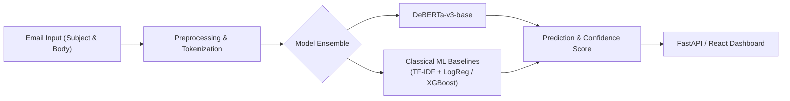

# PhishGuard - Phishing Detection with NLP & Transformers

[](https://www.python.org/downloads/)
[](https://pytorch.org/)
[](LICENSE)
[]()

> 🚧 **Status:** Under Active Development

---

## 📌 Overview

**PhishGuard** is an end-to-end phishing email detection system that fine-tunes state-of-the-art transformer models (specifically **DeBERTa-v3-base**) and systematically benchmarks them against classical machine learning baselines (Logistic Regression, Gradient Boosted Trees / XGBoost with TF-IDF). The project delivers a modular architecture encompassing data preprocessing, model fine-tuning, benchmark evaluation, a high-throughput **FastAPI** inference backend, and a modern **React** frontend for real-time classification.

---

## 🏗️ Architecture



---

## 📁 Project Structure

```text
PhishGuard/
├── api/
│   ├── __init__.py
│   └── server.py             # FastAPI prediction server
├── evals/
│   ├── __init__.py
│   └── evaluate.py           # Evaluation framework & metric benchmarking
├── src/
│   ├── __init__.py
│   ├── config.py             # Dataclass configurations (Model, Data, Training)
│   ├── dataset.py            # PyTorch Dataset & data loader pipelines
│   ├── model.py              # DeBERTa-based PhishingDetector module
│   ├── train.py              # Fine-tuning and validation loop
│   └── baseline.py           # Classical ML baselines (TF-IDF + LogReg/GBT)
├── tests/
│   ├── __init__.py
│   └── test_model.py         # Unit tests
├── .gitignore
├── LICENSE                   # MIT License
├── README.md
└── requirements.txt          # Python dependencies
```

---

## 🚀 Quick Start

### 1. Installation

Clone the repository and set up a Python virtual environment:

```bash
git clone https://github.com/apurvgupta/PhishGuard.git
cd PhishGuard

python -m venv .venv
source .venv/bin/activate  # On Windows: .venv\Scripts\activate

pip install -r requirements.txt
```

### 2. Train Model

To fine-tune DeBERTa-v3 on your training corpus:

```bash
python -m src.train
```

### 3. Evaluate Baselines & Models

Run benchmark evaluations across classical baselines and the fine-tuned transformer:

```bash
python -m evals.evaluate
```

### 4. Serve the API

Start the FastAPI inference server:

```bash
uvicorn api.server:app --host 0.0.0.0 --port 8000 --reload
```

The API docs will be available at [http://localhost:8000/docs](http://localhost:8000/docs).

---

## 📊 Benchmark Results

| Model | Precision | Recall | F1 Score | ROC-AUC |
| :--- | :---: | :---: | :---: | :---: |
| **TF-IDF + Logistic Regression** | TBD | TBD | TBD | TBD |
| **TF-IDF + XGBoost** | TBD | TBD | TBD | TBD |
| **DeBERTa-v3-base** | TBD | TBD | TBD | TBD |
| **Ensemble (DeBERTa + XGBoost)** | TBD | TBD | TBD | TBD |

---

## 🛠️ Tech Stack

- **Deep Learning & NLP:** PyTorch, Hugging Face Transformers (`microsoft/deberta-v3-base`), Hugging Face Datasets
- **Classical ML:** Scikit-Learn, XGBoost
- **API & Serving:** FastAPI, Uvicorn, Pydantic
- **Frontend:** React, TailwindCSS
- **Experiment Tracking:** Weights & Biases (W&B)
- **Testing:** Pytest

---

## 📄 License

Distributed under the MIT License. See [`LICENSE`](LICENSE) for more information.
